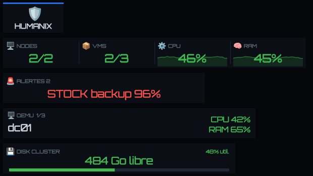
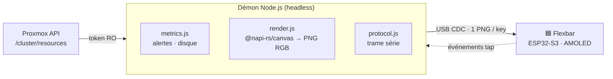
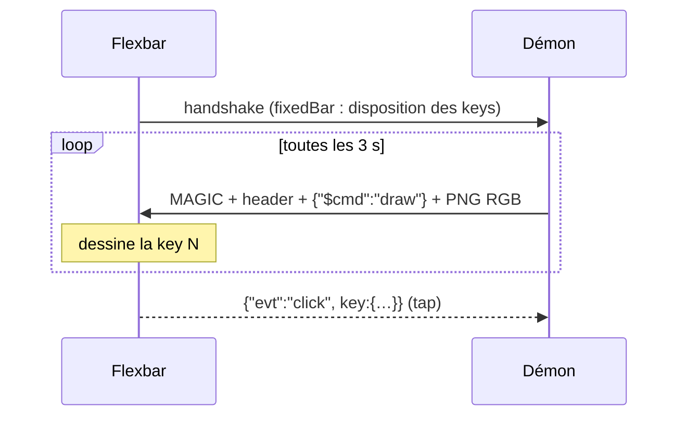
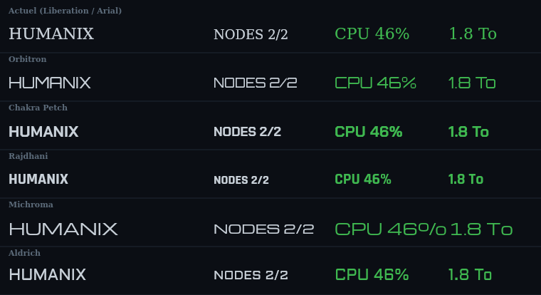

<div align="center">

# ⚡ Flexbar Cockpit

### La **ENIAC Flexbar** détournée en cockpit de supervision **Proxmox** — sans FlexDesigner.

[](LICENSE)
[](https://nodejs.org)
[](https://www.proxmox.com)
[](https://www.espressif.com)

[](https://github.com/Meg4R0M/flexbar-cockpit/stargazers)



**Un nœud Linux. Un câble USB. Le cluster entier sur une barre AMOLED.**

</div>

---

## 🎯 Le pitch

La Flexbar est une superbe barre tactile AMOLED… livrée avec **FlexDesigner**, une appli Electron
qu'il faut garder ouverte en permanence sur un poste **graphique**. Frustrant quand on veut juste
un **écran d'état permanent posé à côté du rack**.

Alors on a **rétro-conçu son protocole série** (USB CDC, en clair) et écrit un **démon headless**
qui la pilote depuis n'importe quel Linux — typiquement un **LXC sur le cluster Proxmox qu'elle
supervise**. Résultat : nœuds, VMs, CPU/RAM, alertes et disque, en temps réel, **zéro appli
graphique**.

> 🧠 Le firmware d'usine est **conservé** — on ne fait que parler sa langue.

## ✨ Fonctionnalités

|  |  |
|---|---|
| 🖥️ **Vue cluster** | nœuds en ligne · VMs actives · CPU % · RAM % agrégés |
| 📈 **Sparklines** | historique glissant CPU/RAM en fond de tuile |
| 🚨 **Alertes auto** | nœud HS + stockage ≥ 80 % / ≥ 90 %, dérivées de l'état réel |
| 🐧 **Rotation VMs** | LXC/QEMU, **templates exclus**, CPU/RAM par invité |
| 💾 **Disque cluster** | espace libre **agrégé** + jauge d'utilisation |
| 🎨 **Style** | emojis couleur · police [Orbitron](https://fonts.google.com/specimen/Orbitron) · code couleur par seuil |
| 🔌 **Résilient** | reconnexion auto (la barre se ré-énumère au boot) |
| 🔒 **Lecture seule** | token PVEAuditor — aucune action possible sur le cluster |

## 🖼️ Anatomie du cockpit

De haut en bas sur l'image = de gauche à droite sur la barre (5 keys) :

| # | Tuile | Contenu |
|---|-------|---------|
| 0 | 🛡 **Marque** | logo / wordmark |
| 1 | 🖥 **Stats** | `NODES` · `VMS` · `CPU` (+ sparkline) · `RAM` (+ sparkline) |
| 2 | 🚨 **Alertes** | worst-of du cluster, rotation, ou ✅ **OK** |
| 3 | 🐧 **VMs** | rotation sur les invités, nom + CPU/RAM % (ou *stoppé*) |
| 4 | 💾 **Disque** | `X To libre` + jauge d'utilisation |

## 🏗️ Architecture



Aucune dépendance graphique : `@napi-rs/canvas` (Skia) génère les PNG côté serveur, le démon les
pousse sur le fil série.

## 🚀 Démarrage rapide (démon)

Sur le nœud Linux où la barre est branchée (recette LXC complète + systemd :
**[`daemon/DEPLOY.md`](daemon/DEPLOY.md)**) :

```bash
# 1) Node 20 + polices — un LXC minimal n'en a AUCUNE (sinon : texte invisible !)
apt-get install -y nodejs fontconfig fonts-liberation fonts-dejavu-core fonts-noto-color-emoji

# 2) Démon
cd daemon && npm install --omit=dev
cp socbar-daemon.config.example.json socbar-daemon.config.json   # ← url + token Proxmox

# 3) Go
node daemon.js --demo    # données fictives (valide l'affichage)
node daemon.js           # données réelles du cluster
```

Crée un token **lecture seule** : *Datacenter → Permissions → API Tokens*, rôle `PVEAuditor`.

## 🔬 Comment le protocole a été cassé

Capturé via un shim `serialport` posé entre FlexDesigner et la barre (**flux non chiffré**).
Chaque dessin = une trame binaire, puis un **PNG brut** :

```
MAGIC (32 o constants)  5a0000a5 a9c4d1f2 … 8c7a2d9f
en-tête (8×uint32 LE)   [0x1000, 1, 1, 0, len, len, 0, type]   type 8 = données
payload                 aafcfdfe + jsonLen + binLen + total + <JSON> + <binaire>
  JSON   {"event":"$plugin-N","data":{"$cmd":"draw"}}      ← N = index de la key
  binaire  \x89PNG … IEND                                   ← PNG RGB aux dims de la key
```



Tout est documenté dans **[`PROTOCOL.md`](PROTOCOL.md)** ; le codec vit dans
[`daemon/protocol.js`](daemon/protocol.js).

## 🧨 Pièges durement gagnés

<details>
<summary><b>PNG RGB, pas RGBA</b> — sinon la barre affiche des rayures</summary>

La barre décode le PNG en **colortype 2 (RGB)**. Un PNG RGBA (le défaut de canvas) sort en
zébrures illisibles. `daemon/png.js` reconvertit explicitement en RGB via `pngjs`.
</details>

<details>
<summary><b>Un LXC minimal n'a AUCUNE police</b> — texte invisible, barre « vide »</summary>

`@napi-rs/canvas` dessine les fonds mais **pas le texte** → PNG ~762 o au lieu de ~7 Ko.
Fix : `fonts-liberation fonts-dejavu-core` + `fc-cache`. Diagnostic : `fc-list | wc -l == 0`.
</details>

<details>
<summary><b>Emojis couleur : installer la police ne suffit pas</b></summary>

Skia rend des tofu tant que la police n'est pas **enregistrée explicitement** via
`GlobalFonts.registerFromPath(...)`. La couleur des emojis est intrinsèque (ignore `fillStyle`).
`render.js` s'en charge au chargement.
</details>

<details>
<summary><b>La barre se ré-énumère</b> — le port disparaît à chaque (dé)connexion</summary>

Fermer le port série resette l'ESP32 → nouveau `/dev/ttyACM*`. Le démon se reconnecte tout seul
(auto-détection par VID/PID `303A:82BF`). En LXC : passthrough résilient (cf. `DEPLOY.md`).
</details>

<details>
<summary><b>Stockage non partagé = un par nœud</b> — dédup par nom = données faussées</summary>

Un `lvmthin` local existe une fois **par nœud**, avec un usage différent. Déduire par nom seul
masquait le nœud chargé. Clé correcte : `nom` si partagé, sinon `nom@nœud` (cf. `metrics.js`).
</details>

## 🗂️ Structure

```
daemon/            ⭐ le démon headless (Proxmox → barre) — commence ici
  DEPLOY.md          recette LXC privilégié + passthrough USB + systemd
  render.js          widgets → PNG (emoji + Orbitron + sparklines + jauge)
  protocol.js        codec de la trame série
  metrics.js         alertes + agrégat disque
  proxmox.js         client API (token lecture seule)
  fonts/             Orbitron (OFL)
backend/           le plugin FlexDesigner d'origine (macOS)  →  PLUGIN.md
PROTOCOL.md        le protocole série rétro-conçu
assets/            captures
```

## 🛣️ Roadmap

- [x] Démon headless pilotant la barre sans FlexDesigner
- [x] Cockpit Proxmox : nœuds, VMs, alertes, disque
- [x] Emojis couleur + police Orbitron + sparklines
- [ ] Couleur des sparklines selon le niveau (vert → orange → rouge)
- [ ] Drill-down tactile (tap → liste des nœuds / top VMs)
- [ ] Rotation « uptime des sites » dans une tuile
- [ ] Initialisation autonome de la disposition des keys

## 🔤 Polices & 📜 Licence

- Code sous **[MIT](LICENSE)**.
- Police UI **Orbitron** sous **SIL OFL 1.1** (embarquée — [`daemon/fonts/README.md`](daemon/fonts/README.md)).
- **Zekton** (la police d'ENIAC) est **commerciale**, donc non incluse. Si tu la possèdes, dépose
  `Zekton.ttf` dans `daemon/fonts/` et change la famille dans `render.js`.

<details>
<summary>🎨 Pourquoi Orbitron ? (le comparatif)</summary>

Zekton étant introuvable/commerciale, plusieurs alternatives libres (OFL) ont été rendues **sur
la vraie pipeline** de la barre avant de trancher :


</details>

## ⚖️ Avertissement

Projet indépendant, **non affilié à ENIAC**. Le protocole a été rétro-conçu à des fins
d'**interopérabilité**, sur du matériel possédé, à partir d'un flux **non chiffré**. Le firmware
d'usine n'est ni modifié ni redistribué. Usage responsable.

---

<div align="center">
<sub>Fait avec ☕ et un analyseur de trames série · <a href="PROTOCOL.md">le protocole</a> · <a href="daemon/DEPLOY.md">déployer</a></sub>
</div>
